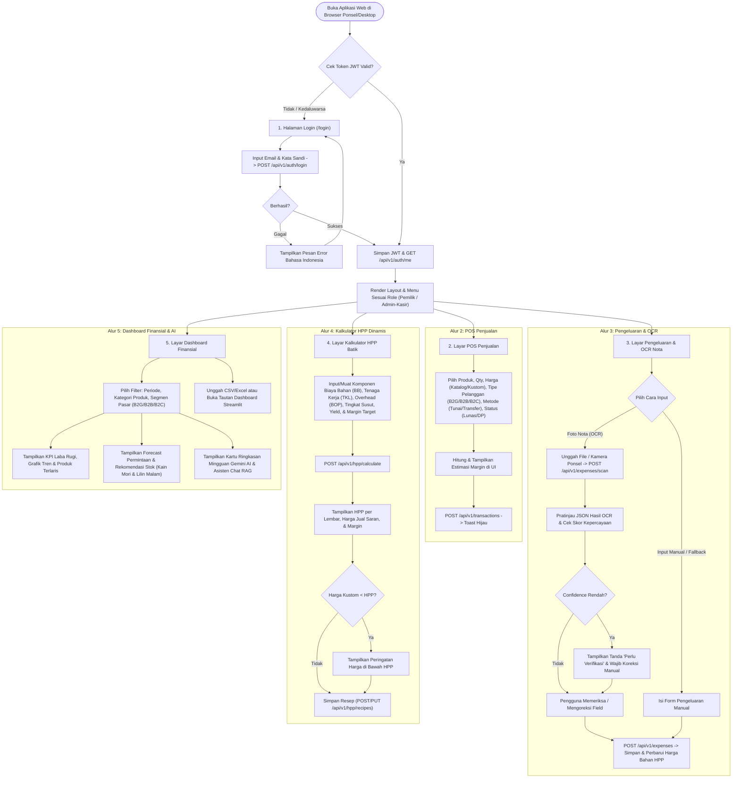

# Product Requirements Document (PRD) — Frontend

**Proyek:** Digitalisasi Manajemen Keuangan dan Sistem Cerdas Analisis HPP serta Rekomendasi Stok pada UMKM Kerajinan Azrya Batik  
**ID Tim Capstone:** A26-CS087  
**PIC Frontend:** FS 1 – Sandi Setianto (Front-End Lead & UI/UX)  
**Dokumen Acuan:** [Project Plan - A26-CS087 - Google Dokumen.pdf](file:///c:/Users/Martrio/Documents/Capsthon%20project/Project%20Plan%20-%20A26-CS087%20-%20Google%20Dokumen.pdf)

---

## 1. Project Overview & Frontend Scope

### 1.1 Ringkasan Produk
Aplikasi ini adalah *Single Page Application* (SPA) berbasis web yang responsif (*mobile-first*) untuk membantu UMKM **Azrya Batik** (produsen batik tulis autentik, seragam instansi/ASN B2G, selendang, dan tas etnik kombinasi kulit di Probolinggo) mendigitalisasi pencatatan kas operasional, mendokumentasikan nota belanja bahan baku secara digital menggunakan OCR, menghitung Harga Pokok Penjualan (HPP) per lembar/unit secara dinamis dan akurat, serta menyajikan rekap laba rugi instan, peramalan (*forecasting*) kebutuhan stok, dan ringkasan finansial cerdas berbasis AI berbahasa Indonesia ([Bagian A & B.1](file:///c:/Users/Martrio/Documents/Capsthon%20project/Project%20Plan%20-%20A26-CS087%20-%20Google%20Dokumen.pdf)).

### 1.2 Tech Stack & Arsitektur Sisi Frontend
Sesuai [Bagian B.2 & E.2](file:///c:/Users/Martrio/Documents/Capsthon%20project/Project%20Plan%20-%20A26-CS087%20-%20Google%20Dokumen.pdf):
* **Framework Utama:** React.js 18 dengan *build tool* **Vite** pada struktur monorepo `/frontend`.
* **Styling & UI:** **Tailwind CSS** dengan pendekatan tata letak ponsel-pertama (*mobile-first*) dan komponen UI modern.
* **HTTP Client:** **Axios** menggunakan *single instance* terpusat yang dilengkapi *interceptor* untuk injeksi token autentikasi (JWT) serta penanganan error terstandarisasi.
* **Desain & Prototyping:** **Figma** (Mockup 5 layar utama sebelum tahap implementasi kode).
* **Deployment:** **Vercel** (dengan opsi setara *free tier* seperti Netlify/Cloudflare Pages sesuai [Bagian B.2 & E.3](file:///c:/Users/Martrio/Documents/Capsthon%20project/Project%20Plan%20-%20A26-CS087%20-%20Google%20Dokumen.pdf)) yang terhubung ke GitHub CI/CD.
* **Prinsip Arsitektur Decoupled & Keamanan Kunci API:** Frontend **tidak pernah** memanggil layanan AI (FastAPI) atau API pihak ketiga (Gemini) secara langsung dari *browser*. Seluruh komunikasi dilakukan ke REST API Back-End Express (`/api/v1/...`), sehingga tidak ada kunci API rahasia yang terekspos di kode *client-side* ([Bagian B.2 & D - FS 2](file:///c:/Users/Martrio/Documents/Capsthon%20project/Project%20Plan%20-%20A26-CS087%20-%20Google%20Dokumen.pdf)).

### 1.3 Ruang Lingkup Kerja Tim Frontend (In-Scope)
Berdasarkan [Bagian B.3 & D - FS 1](file:///c:/Users/Martrio/Documents/Capsthon%20project/Project%20Plan%20-%20A26-CS087%20-%20Google%20Dokumen.pdf), tanggung jawab tim Frontend meliputi:
1. **Desain UI/UX:** Pembuatan mockup 5 layar utama di Figma dan *design system* komponen dasar (*button, input, table, toast, modal, skeleton*).
2. **Implementasi 5 Alur Layar Utama MVP:**
   * Layar Autentikasi (Login) & *Route Guard* berbasis peran (*role*).
   * Layar POS Penjualan (Kasir).
   * Layar Pencatatan Pengeluaran (Form Manual & Unggah/Kamera Foto Nota via OCR beserta pratinjau dan koreksi).
   * Layar Kalkulator HPP Batik Dinamis & Resep Biaya.
   * Layar Dashboard Finansial Terintegrasi (KPI & grafik laba rugi, produk terlaris, *forecast* stok kain mori & lilin malam, kartu *insight* mingguan Gemini AI + asisten *chat* RAG, filter & unggah data, serta tautan ke dashboard Streamlit).
3. **Dokumentasi Pengguna:** Penyusunan panduan pengguna bergambar untuk pemilik dan kasir (termasuk panduan cara memotret nota agar akurasi OCR optimal) ([Bagian B.6 & F.2 - R1](file:///c:/Users/Martrio/Documents/Capsthon%20project/Project%20Plan%20-%20A26-CS087%20-%20Google%20Dokumen.pdf)).

### 1.4 Batasan Ruang Lingkup (Out-of-Scope Frontend)
Sesuai [Bagian B.7](file:///c:/Users/Martrio/Documents/Capsthon%20project/Project%20Plan%20-%20A26-CS087%20-%20Google%20Dokumen.pdf), tim Frontend **tidak** membangun:
* Integrasi *payment gateway* langsung (UI hanya menyediakan pencatatan metode pembayaran `tunai`/`transfer` dan status `lunas`/`DP`/belum bayar).
* Modul ERP manufaktur pabrikasi skala besar (penjadwalan mesin, MRP penuh, manajemen multi-pabrik).
* Modul perpajakan (PPN/PPh), e-faktur, *payroll*, atau integrasi pengadaan pemerintah.
* Aplikasi *mobile native* (iOS/Android) maupun integrasi *marketplace* (cukup web responsif yang diakses lewat *browser* ponsel).
* Antarmuka bot Telegram/WhatsApp (fitur pengiriman ringkasan ke Telegram/WhatsApp berstatus *stretch goal* di sisi AI Engineer bila waktu sprint tersisa).

---

## 2. Target Users & User Flow

### 2.1 Target Pengguna (User Personas)
Mengacu pada [Bagian B.3 & B.5](file:///c:/Users/Martrio/Documents/Capsthon%20project/Project%20Plan%20-%20A26-CS087%20-%20Google%20Dokumen.pdf), terdapat dua peran pengguna di sistem:
1. **Pemilik UMKM (Owner Azrya Batik):**
   * **Kebutuhan Utama:** Memantau laporan laba rugi bulanan secara instan (di bawah 1 menit), menghitung HPP dan harga jual saran untuk pesanan kain/seragam/selendang/tas agar tidak di bawah modal, melihat tren produk terlaris & rekomendasi pembelian stok bahan baku, serta membaca ringkasan kesehatan bisnis mingguan dari AI.
   * **Hak Akses UI:** Akses penuh ke seluruh 5 layar utama, pengaturan master produk/bahan/resep HPP, serta fitur analitik & AI Advisor.
2. **Admin / Kasir:**
   * **Kebutuhan Utama:** Mencatat transaksi penjualan harian dari galeri/WhatsApp/medsos dengan cepat melalui ponsel atau komputer kasir, serta mendokumentasikan nota belanja bahan baku/operasional secara digital.
   * **Hak Akses UI:** Menu navigasi disesuaikan dengan peran (*role-based access*) untuk operasional pencatatan POS Penjualan dan Pengeluaran/OCR Nota.

### 2.2 Alur Navigasi Pengguna (End-to-End User Flow)



---

## 3. Page-by-Page & Component Breakdown

Sesuai spesifikasi pada [Bagian B.3, B.4, B.5, dan D - FS 1](file:///c:/Users/Martrio/Documents/Capsthon%20project/Project%20Plan%20-%20A26-CS087%20-%20Google%20Dokumen.pdf), aplikasi terdiri dari **1 kerangka tata letak global (App Shell)**, **6 komponen dasar reusable**, dan **5 layar utama (Views)**:

### 3.0 Komponen Global & Reusable UI Kit (Minggu 1 - FS 1)
1. **Responsive App Shell & Navigation Bar:** Navigasi bawah (*bottom navigation*) atau *drawer* pada layar ponsel dan *sidebar* pada layar desktop. Menyembunyikan atau menampilkan menu berdasarkan `role` dari *route guard*.
2. **Base Components:**
   * `Button`: Varian *primary, secondary, danger, outline* dengan *state disabled* dan *spinner* saat *loading*.
   * `Input / Select / FileDropzone`: Komponen input teks, angka (format Rupiah/satuan), tanggal, *dropdown*, dan input kamera/file (`accept="image/*"` dengan atribut `capture="environment"` untuk kamera ponsel).
   * `Table / CardList`: Tabel data yang otomatis beradaptasi menjadi *stacked card* pada layar ponsel.
   * `Toast`: Notifikasi melayang berwarna hijau untuk status berhasil dan merah/kuning untuk pesan error/peringatan dalam bahasa Indonesia.
   * `Modal`: Dialog konfirmasi dan pratinjau bukti nota/detail transaksi.
   * `Skeleton & Spinner`: Penanda visual saat *fetching* data API atau menunggu proses AI/OCR.

---

### 3.1 Layar 1: Autentikasi / Login (`/login`)
* **Tujuan:** Mengautentikasi Pemilik dan Admin/Kasir serta mengamankan sesi akses aplikasi ([Bagian B.3 Alur 1](file:///c:/Users/Martrio/Documents/Capsthon%20project/Project%20Plan%20-%20A26-CS087%20-%20Google%20Dokumen.pdf)).
* **Rincian Komponen UI & Fungsinya:**
  * **Form Login:** Input `email` (validasi format email) dan `password` (dengan tombol *show/hide* kata sandi).
  * **Tombol Masuk (Submit):** Memicu panggilan `POST /api/v1/auth/login`, menampilkan *spinner* selama proses autentikasi.
  * **Alert Error Banner:** Menampilkan pesan error berbahasa Indonesia beserta langkah perbaikan bila kredensial salah (`UNAUTHORIZED`) atau sesi sebelumnya telah berakhir/token kedaluwarsa.

---

### 3.2 Layar 2: POS Penjualan / Kasir (`/pos` atau `/transactions`)
* **Tujuan:** Mencatat transaksi penjualan masuk dari pesanan kustom/galeri/WhatsApp beserta perhitungan margin secara langsung ([Bagian B.3 Alur 2 & B.5](file:///c:/Users/Martrio/Documents/Capsthon%20project/Project%20Plan%20-%20A26-CS087%20-%20Google%20Dokumen.pdf)).
* **Rincian Komponen UI & Fungsinya:**
  * **Pemilih Produk & Keranjang Item (`transaction_items`):**
    * Dropdown/pencarian produk dari katalog (`products`: kain batik tulis, seragam, selendang, tas).
    * Input jumlah (`qty`) beserta penanda satuan (`satuan`).
    * Input `harga_satuan`: Otomatis terisi dari `harga_katalog`, namun dapat diubah menjadi **harga kustom** untuk pesanan khusus/seragam ([Bagian D - FS 1 M2](file:///c:/Users/Martrio/Documents/Capsthon%20project/Project%20Plan%20-%20A26-CS087%20-%20Google%20Dokumen.pdf)).
    * Panel informasi `hpp_snapshot` dan **indikator Margin** per item/transaksi yang dihitung secara *real-time* ($\text{Harga Jual} - \text{HPP}$).
  * **Form Atribut Transaksi (`transactions`):**
    * Pemilih Segmen/Tipe Pelanggan (`pelanggan_tipe`): Pilihan radio/segmented button `B2G` (Dinas/Instansi), `B2B` (Korporat/Sekolah), atau `B2C` (Kolektor/Umum).
    * Pemilih Metode Pembayaran (`metode_bayar`): `Tunai` atau `Transfer`.
    * Pemilih Status Pembayaran (`status_bayar`): `Lunas` atau `DP` (termasuk status belum bayar sesuai [Bagian B.7](file:///c:/Users/Martrio/Documents/Capsthon%20project/Project%20Plan%20-%20A26-CS087%20-%20Google%20Dokumen.pdf) — hanya pencatatan status tanpa *payment gateway*).
  * **Ringkasan Kas Masuk & Tombol Simpan Transaksi:** Menampilkan total nominal transaksi, estimasi laba kotor/margin, dan tombol simpan ke `/api/v1/transactions`.
  * **Tabel/Daftar Riwayat Transaksi Kasir:** Menampilkan transaksi terbaru yang telah tercatat beserta filter singkat dan modal detail item.

---

### 3.3 Layar 3: Pengeluaran Cerdas via OCR & Input Manual (`/expenses`)
* **Tujuan:** Mendokumentasikan nota belanja bahan baku (canting, lilin malam, kain mori, pewarna) maupun pengeluaran operasional secara digital, baik lewat ekstraksi otomatis OCR maupun form manual ([Bagian B.3 Alur 3, D - FS 1, & D - AE 1](file:///c:/Users/Martrio/Documents/Capsthon%20project/Project%20Plan%20-%20A26-CS087%20-%20Google%20Dokumen.pdf)).
* **Rincian Komponen UI & Fungsinya:**
  * **Komponen Unggah / Kamera Foto Nota (`OCR Scanner Panel`):**
    * Tombol ambil foto langsung dari kamera ponsel atau pilih file gambar nota beserta validasi ukuran dan tipe file di sisi klien sebelum dikirim ke `POST /api/v1/expenses/scan`.
    * **Panduan Singkat Memotret Nota (Tooltip/Collapsible Info):** Petunjuk agar foto tidak miring, tidak gelap, dan tulisan terlihat jelas ([Bagian F.2 - R1](file:///c:/Users/Martrio/Documents/Capsthon%20project/Project%20Plan%20-%20A26-CS087%20-%20Google%20Dokumen.pdf)).
    * **Pratinjau Citra Nota:** Menampilkan foto nota yang diunggah berdampingan dengan form hasil pembacaan OCR.
  * **Form Pratinjau & Koreksi Hasil OCR / Form Pengeluaran Manual:**
    * Field utama pengeluaran (`expenses`): `tanggal`, `toko`, `kategori` (bahan baku, alat, operasional — otomatis terisi dari klasifikasi AI bila melalui jalur OCR), `total`, dan penanda `sumber` (`ocr` atau `manual`).
    * Tabel rincian baris item nota (hasil ekstraksi JSON OCR): nama `item` (terhubung ke pencocokan *fuzzy matching* master bahan `materials`), `qty`, `satuan`, `harga` per satuan, dan subtotal.
    * **Badge Skor Kepercayaan & Penanda "Perlu Verifikasi":** Bila respons API atau skor `confidence` rendah (`OCR_LOW_CONFIDENCE`), komponen wajib menampilkan *badge* peringatan mencolok **"Perlu Verifikasi"** pada nota/field terkait dan menahan penyimpanan otomatis hingga pengguna memvalidasi/mengedit isian ([Bagian B.3 & F.2 - R1](file:///c:/Users/Martrio/Documents/Capsthon%20project/Project%20Plan%20-%20A26-CS087%20-%20Google%20Dokumen.pdf)).
    * **Indikator Pembaruan Harga Bahan HPP:** Informasi bahwa harga baru dari nota bahan baku yang disimpan akan memperbarui riwayat `material_prices` (rata-rata bergerak terbobot) untuk perhitungan HPP ([Bagian B.3 Alur 3 & B.5](file:///c:/Users/Martrio/Documents/Capsthon%20project/Project%20Plan%20-%20A26-CS087%20-%20Google%20Dokumen.pdf)).
  * **Daftar Riwayat Pengeluaran & Bukti Digital:** Tabel riwayat pengeluaran lengkap dengan tautan pratinjau foto nota (`bukti_url`).

---

### 3.4 Layar 4: Kalkulator HPP Batik Dinamis (`/hpp`)
* **Tujuan:** Menghitung HPP per lembar/unit produk secara otomatis berdasarkan formula biaya bahan rata-rata bergerak terbobot, tenaga kerja langsung, overhead, faktor susut, dan *yield*, serta memberi peringatan bila harga jual kustom berada di bawah HPP ([Bagian B.3 Alur 4 & B.4](file:///c:/Users/Martrio/Documents/Capsthon%20project/Project%20Plan%20-%20A26-CS087%20-%20Google%20Dokumen.pdf)).
* **Rincian Komponen UI & Fungsinya:**
  * **Selector Produk / Resep (`hpp_recipes`):** Memilih produk acuan (kain batik tulis, seragam, selendang, tas) untuk memuat resep biaya yang tersimpan atau membuat simulasi perhitungan baru.
  * **Form Dinamis Komponen Biaya (Mengacu pada Formula [Bagian B.4](file:///c:/Users/Martrio/Documents/Capsthon%20project/Project%20Plan%20-%20A26-CS087%20-%20Google%20Dokumen.pdf)):**
    1. **Panel Biaya Bahan ($\text{BB}$):** Baris dinamis bahan baku dari master `materials` (kain mori dalam meter, lilin malam dalam gram, pewarna dalam gram × jumlah celup). Menampilkan kuantitas pemakaian ($q_i$), harga rata-rata bergerak terbobot terbaru ($h_i$), dan input faktor susut bahan ($s_i$).
       $$\text{BB} = \sum_i q_i \cdot h_i \cdot (1 + s_i)$$
    2. **Panel Tenaga Kerja Langsung ($\text{TKL}$):** Input panjang meter canting ($m_{\text{canting}}$) × upah mencanting per meter ($u_{\text{canting}}$), upah mewarnai ($u_{\text{warna}}$), dan upah melorod ($u_{\text{lorod}}$).
       $$\text{TKL} = m_{\text{canting}} \cdot u_{\text{canting}} + u_{\text{warna}} + u_{\text{lorod}}$$
    3. **Panel Biaya Overhead Pabrik ($\text{BOP}$):** Input komponen penyusutan alat (Nilai Perolehan $\text{NP}$, Nilai Sisa $\text{NS}$, Umur Pakai $\text{UP}$, dan alokasi per produk $a$), biaya energi (gas/listrik/air), serta biaya kemasan.
       $$\text{Penyusutan} = \frac{\text{NP} - \text{NS}}{\text{UP}} \cdot a$$
    4. **Panel Parameter Hasil & Target Harga:** Input hasil produksi ($\text{Yield}$), target margin ($m_{\text{target}}$ dalam persen), dan **Input Simulasi Harga Jual Kustom**.
  * **Kartu Hasil Kalkulasi HPP & Harga Saran:**
    * Menampilkan angka $\text{HPP}_{\text{unit}} = \frac{\text{BB} + \text{TKL} + \text{BOP}}{\text{Yield}}$, rincian persentase kontribusi biaya ($\text{BB}$, $\text{TKL}$, $\text{BOP}$), **Harga Jual Saran** $\left(\frac{\text{HPP}_{\text{unit}}}{1 - m_{\text{target}}}\right)$, dan nominal/persentase **Margin**.
  * **Alert Peringatan Harga di Bawah HPP:** Komponen *warning banner* berwarna merah/kuning yang muncul secara reaktif apabila nilai **Harga Jual Kustom < $\text{HPP}_{\text{unit}}$** agar pemilik tidak menjual pesanan di bawah modal ([Bagian B.3 Alur 4](file:///c:/Users/Martrio/Documents/Capsthon%20project/Project%20Plan%20-%20A26-CS087%20-%20Google%20Dokumen.pdf)).
  * **Tombol Simpan Resep HPP:** Menyimpan konfigurasi resep produk ke `/api/v1/hpp/recipes` dan memperbarui acuan HPP produk.

---

### 3.5 Layar 5: Dashboard Finansial, Forecasting, & AI Advisor (`/dashboard`)
* **Tujuan:** Menyajikan rekap laba rugi instan (< 1 menit), visibilitas produk terlaris, prediksi permintaan & rekomendasi stok bahan baku, serta *insight* naratif dan asisten keuangan berbasis Gemini AI ([Bagian B.3 Alur 5, D - FS 1, AE 2, DS 1, & DS 2](file:///c:/Users/Martrio/Documents/Capsthon%20project/Project%20Plan%20-%20A26-CS087%20-%20Google%20Dokumen.pdf)).
* **Rincian Komponen UI & Fungsinya:**
  * **Bar Filter Global Dashboard:** Filter `periode` (rentang tanggal/mingguan/bulanan), `kategori` produk (kain, seragam, selendang, tas), dan `segmen pasar` (`B2G`, `B2B`, `B2C`) ([Bagian B.3 Alur 5 & D - DS 1](file:///c:/Users/Martrio/Documents/Capsthon%20project/Project%20Plan%20-%20A26-CS087%20-%20Google%20Dokumen.pdf)).
  * **Kartu Ringkasan KPI Keuangan (`KPI Summary Cards`):** Menampilkan **Omzet (Penjualan)**, **Total HPP**, **Laba Kotor** ($\text{Penjualan} - \text{HPP}$), **Laba Bersih** ($\text{Laba Kotor} - \text{Beban Operasional}$), **Margin (%)**, dan **Arus Kas** ([Bagian B.4 & D - DS 1 M3](file:///c:/Users/Martrio/Documents/Capsthon%20project/Project%20Plan%20-%20A26-CS087%20-%20Google%20Dokumen.pdf)).
  * **Grafik Laba Rugi & Produk Terlaris (`Charts Panel`):**
    * Grafik tren pendapatan vs pengeluaran/laba rugi per periode (`/api/v1/dashboard/trend`).
    * Grafik peringkat produk terlaris per kategori/segmen.
  * **Panel Forecasting Permintaan & Rekomendasi Stok (`Stock & Demand Forecast Card`):**
    * Menampilkan grafik/tabel prediksi penjualan mingguan per kategori (`/api/v1/forecast/demand`) dan rekomendasi pembelian stok bahan baku utama: **kain mori (dalam satuan meter)** dan **lilin malam (dalam satuan kg)** (`/api/v1/forecast/stock`) beserta status `stok_saat_ini` vs `stok_minimum`.
    * Menampilkan **penjelasan satuan dan asumsi** perhitungan rekomendasi stok ($\text{prediksi permintaan} \times \text{pemakaian resep} + \text{stok pengaman} - \text{stok saat ini}$) serta **Badge Label Sumber Data** (`ASLI`, `SIMULASI`, atau `SINTETIS`) sesuai klausul transparansi data ([Bagian D - DS 2, E.4, & F.2 - R6](file:///c:/Users/Martrio/Documents/Capsthon%20project/Project%20Plan%20-%20A26-CS087%20-%20Google%20Dokumen.pdf)).
  * **Kartu Insight Naratif Mingguan AI (`AI Business Advisor Card`):**
    * Menampilkan hasil analisis mingguan berbahasa Indonesia dari Gemini (`/api/v1/insights/weekly` & `/api/v1/insights/history`) yang terstruktur atas 4 bagian: **Ringkasan**, **Sorotan**, **Risiko**, dan **Rekomendasi** ([Bagian D - AE 2 M1](file:///c:/Users/Martrio/Documents/Capsthon%20project/Project%20Plan%20-%20A26-CS087%20-%20Google%20Dokumen.pdf)).
    * **Label Fallback Cadangan:** Bila API Gemini mengalami *timeout* atau kuota habis, kartu tetap merender ringkasan berbasis aturan (*rule-based template*) dari backend dengan *badge* jelas **"Ringkasan otomatis tanpa AI"** ([Bagian F.2 - R2](file:///c:/Users/Martrio/Documents/Capsthon%20project/Project%20Plan%20-%20A26-CS087%20-%20Google%20Dokumen.pdf)).
  * **Panel / Widget Asisten Keuangan RAG (`AI Chat Assistant`):**
    * Antarmuka tanya-jawab interaktif yang terhubung ke `POST /api/v1/chat` untuk menjawab pertanyaan pengguna seputar 4 kelas *intent* (tanya HPP, laporan keuangan, stok bahan, atau cara pakai aplikasi) serta menampilkan respons penolakan sopan bila pertanyaan berada di luar konteks bisnis Azrya Batik ([Bagian B.5 & D - AE 2 M3](file:///c:/Users/Martrio/Documents/Capsthon%20project/Project%20Plan%20-%20A26-CS087%20-%20Google%20Dokumen.pdf)).
  * **Fitur Unggah Data (CSV/Excel) & Tautan Dashboard Streamlit:**
    * Komponen unggah berkas CSV/Excel untuk pembaruan data analitik dan tombol tautan eksternal untuk membuka **Dashboard Analitik Streamlit** ([Bagian B.6, C - M3, & D - FS 1 M3](file:///c:/Users/Martrio/Documents/Capsthon%20project/Project%20Plan%20-%20A26-CS087%20-%20Google%20Dokumen.pdf)).

---

## 4. User Stories & Acceptance Criteria (Frontend Focus)

Seluruh *Acceptance Criteria* di bawah ini menggunakan pola **Given-When-Then** sesuai spesifikasi di [Bagian B.3, B.4, B.5, D, dan F.2](file:///c:/Users/Martrio/Documents/Capsthon%20project/Project%20Plan%20-%20A26-CS087%20-%20Google%20Dokumen.pdf).

### US-01: Autentikasi Pengguna & Proteksi Rute (Route Guard)
* **Sebagai** Pemilik atau Admin/Kasir Azrya Batik, **saya ingin** masuk menggunakan email dan kata sandi **agar** sesi kerja saya aman dan menu yang tampil sesuai dengan peran saya.
* **Acceptance Criteria:**
  * **Scenario 1 (Login Berhasil & Menu Sesuai Peran):**
    * **Given** pengguna berada di halaman Login dan telah mengisi `email` serta `password` yang valid,
    * **When** pengguna menekan tombol "Masuk",
    * **Then** tombol menampilkan indikator *loading* (spinner), token JWT disimpan, aplikasi menampilkan *toast* hijau, dan pengguna diarahkan ke layar utama dengan menu navigasi yang sesuai dengan `role` (`pemilik` atau `admin/kasir`).
  * **Scenario 2 (Kredensial Salah):**
    * **Given** pengguna berada di halaman Login,
    * **When** pengguna mengirimkan kombinasi email/kata sandi yang salah dan API merespons dengan kode `UNAUTHORIZED`,
    * **Then** aplikasi menampilkan pesan error berbahasa Indonesia ("Email atau kata sandi salah, silakan periksa kembali") tanpa me-*reload* halaman.
  * **Scenario 3 (Token Kedaluwarsa / Sesi Berakhir):**
    * **Given** pengguna sedang berada di halaman terproteksi namun token JWT telah kedaluwarsa,
    * **When** pengguna melakukan aksi yang memanggil endpoint `/api/v1/*` dan menerima respons `401 / UNAUTHORIZED`,
    * **Then** Axios *interceptor* menghapus sesi lokal, mengarahkan pengguna kembali ke halaman Login, dan menampilkan pesan informasi bahwa sesi telah berakhir beserta instruksi untuk login kembali.

### US-02: Pencatatan Penjualan di POS Kasir
* **Sebagai** Admin/Kasir atau Pemilik, **saya ingin** mencatat penjualan produk beserta tipe pelanggan, metode bayar, dan status bayar **agar** kas masuk langsung tercatat dan margin terlihat.
* **Acceptance Criteria:**
  * **Scenario 1 (Transaksi POS Valid & Tampilan Margin):**
    * **Given** pengguna berada di layar POS Kasir dan telah memilih produk, mengisi jumlah (`qty` > 0), harga jual (katalog atau kustom), tipe pelanggan (`B2G`/`B2B`/`B2C`), metode bayar (`tunai`/`transfer`), serta status bayar (`lunas`/`DP`),
    * **When** pengguna menekan tombol "Simpan Transaksi",
    * **Then** UI menampilkan *spinner* pada tombol, mengirim data ke `POST /api/v1/transactions`, menampilkan *toast* hijau saat sukses, menampilkan nilai margin transaksi, dan mengosongkan form untuk transaksi berikutnya.
  * **Scenario 2 (Validasi Form POS Kosong/Tidak Valid):**
    * **Given** pengguna berada di layar POS Kasir dan belum memilih produk atau memasukkan jumlah `<= 0`,
    * **When** pengguna mencoba menekan tombol "Simpan Transaksi",
    * **Then** validasi *client-side* menahan pengiriman request dan menampilkan pesan error berbahasa Indonesia tepat di bawah field yang belum lengkap.

### US-03: Pencatatan Pengeluaran Cerdas via OCR Foto Nota & Fallback Manual
* **Sebagai** Pemilik atau Admin/Kasir, **saya ingin** mengunggah atau memotret nota belanja bahan batik agar datanya terisi otomatis ke form pengeluaran, serta dapat mengoreksinya sebelum disimpan **agar** nota terdokumentasi digital dan harga bahan HPP diperbarui.
* **Acceptance Criteria:**
  * **Scenario 1 (Ekstraksi OCR Berhasil dengan Kepercayaan Tinggi):**
    * **Given** pengguna berada di layar Pengeluaran dan memilih foto nota (kain mori, lilin malam, canting, atau pewarna),
    * **When** foto dikirim ke `POST /api/v1/expenses/scan`,
    * **Then** UI menampilkan *skeleton/spinner* selama proses pembacaan, lalu mengisi otomatis form pratinjau (`toko`, `tanggal`, daftar `item`, `qty`, `satuan`, `harga`, `total`, `kategori`) untuk diperiksa pengguna sebelum disimpan ke `POST /api/v1/expenses`.
  * **Scenario 2 (Nota Berkepercayaan Rendah / Perlu Verifikasi):**
    * **Given** pengguna mengunggah foto nota yang pudar, miring, atau gelap,
    * **When** respons API mengembalikan skor kepercayaan rendah atau kode/status `OCR_LOW_CONFIDENCE`,
    * **Then** UI **tidak** menyimpan entri secara otomatis, melainkan menampilkan penanda visual mencolok **"Perlu Verifikasi"** pada form pratinjau dan mewajibkan pengguna memeriksa/mengoreksi field secara manual sebelum tombol simpan dapat diselesaikan.
  * **Scenario 3 (Kegagalan Layanan OCR & Fallback Input Manual):**
    * **Given** layanan OCR mengalami *timeout* (`AI_TIMEOUT`) atau gagal membaca gambar sama sekali,
    * **When** respons error diterima oleh Frontend,
    * **Then** aplikasi menampilkan pesan error berbahasa Indonesia beserta langkah perbaikan, dan langsung mengaktifkan mode **Form Pengeluaran Manual** agar pengguna tetap dapat mencatat pengeluaran tanpa terhambat.

### US-04: Perhitungan HPP Dinamis & Peringatan Harga Jual di Bawah Modal
* **Sebagai** Pemilik UMKM, **saya ingin** menghitung HPP per lembar berdasarkan komponen bahan, tenaga kerja, overhead, dan tingkat susut **agar** saya memperoleh harga jual saran yang akurat dan mendapat peringatan jika harga kustom berada di bawah HPP.
* **Acceptance Criteria:**
  * **Scenario 1 (Kalkulasi HPP & Harga Saran):**
    * **Given** pengguna berada di layar Kalkulator HPP dan telah mengisi/memuat komponen biaya bahan ($\text{BB}$), tenaga kerja langsung ($\text{TKL}$), overhead ($\text{BOP}$), faktor susut, $\text{Yield}$, serta target margin,
    * **When** pengguna memicu perhitungan HPP (`POST /api/v1/hpp/calculate`),
    * **Then** layar menampilkan hasil **HPP per lembar/unit**, **Harga Jual Saran**, dan **Margin** secara jelas.
  * **Scenario 2 (Peringatan Harga Kustom di Bawah HPP):**
    * **Given** nilai HPP per lembar telah terhitung di layar Kalkulator HPP,
    * **When** pengguna memasukkan nilai pada field **Harga Jual Kustom** yang lebih kecil daripada nilai **HPP per lembar**,
    * **Then** UI secara instan memunculkan komponen **Peringatan (Warning Alert)** berbahasa Indonesia yang menyatakan bahwa harga jual kustom berada di bawah HPP (berisiko rugi/di bawah modal).

### US-05: Eksplorasi Dashboard Finansial, Forecast Stok, & AI Business Advisor
* **Sebagai** Pemilik UMKM, **saya ingin** melihat rekap laba rugi, tren produk terlaris, rekomendasi stok bahan baku, dan ringkasan AI mingguan dalam satu layar **agar** saya dapat mengambil keputusan bisnis dan stok dalam waktu kurang dari 1 menit.
* **Acceptance Criteria:**
  * **Scenario 1 (Filter Dashboard & Rekonsiliasi Data):**
    * **Given** pengguna berada di layar Dashboard Finansial,
    * **When** pengguna mengubah filter `periode`, `kategori`, atau `segmen pasar` (`B2G`/`B2B`/`B2C`),
    * **Then** komponen KPI laba rugi dan grafik produk terlaris menampilkan *skeleton loader*, memanggil endpoint `/api/v1/dashboard/summary` dan `/api/v1/dashboard/trend` dengan parameter filter terkait, dan merender ulang angka serta grafik yang sesuai dengan database.
  * **Scenario 2 (Tampilan Forecast Stok & Label Transparansi Data):**
    * **Given** pengguna membuka panel Rekomendasi Stok di Dashboard,
    * **When** data dari `/api/v1/forecast/demand` dan `/api/v1/forecast/stock` berhasil dimuat,
    * **Then** UI menampilkan grafik prediksi serta angka rekomendasi stok untuk **kain mori (meter)** dan **lilin malam (kg)** lengkap dengan penjelasan satuan, asumsi perhitungan, serta *badge* label sumber data (`SINTETIS` / `SIMULASI` / `ASLI`).
  * **Scenario 3 (Kartu Insight Gemini AI & Fallback Saat Kuota Habis/Timeout):**
    * **Given** pengguna memuat kartu Ringkasan Keuangan Mingguan atau mengirim pertanyaan ke Asisten Keuangan (`/api/v1/insights/weekly` atau `/api/v1/chat`),
    * **When** layanan Gemini API mengalami gangguan, *timeout* (`AI_TIMEOUT`), atau kuota habis (`AI_QUOTA_EXCEEDED`),
    * **Then** dashboard tetap berfungsi normal tanpa *crash*, menampilkan pesan informasi yang jelas kepada pengguna, dan merender ringkasan cadangan berbasis aturan dengan label **"Ringkasan otomatis tanpa AI"**.

---

## 5. State Management & Data Contract (API Integration)

### 5.1 Arsitektur Client-Side State & Axios Interceptor
Sesuai [Bagian B.2 & B.5](file:///c:/Users/Martrio/Documents/Capsthon%20project/Project%20Plan%20-%20A26-CS087%20-%20Google%20Dokumen.pdf):
1. **Single Axios Instance (`apiClient`):**
   * `baseURL` diarahkan ke variabel lingkungan `VITE_API_BASE_URL` (contoh: `https://<backend-domain>/api/v1`).
   * **Request Interceptor:** Menyisipkan header `Authorization: Bearer <token>` secara otomatis pada setiap panggilan terproteksi.
   * **Response Interceptor:** Menangani struktur respons baku dan memetakan kode error standar ke pesan *user-friendly* berbahasa Indonesia.
2. **State Management:**
   * **Auth & Session State (Global):** Menyimpan profil pengguna (`id`, `nama`, `email`, `role`), status autentikasi, dan token JWT.
   * **Feature / View State (Local per Halaman):** Menyimpan *state* form dinamis (keranjang POS, draf koreksi OCR, parameter kalkulator HPP, filter aktif dashboard, serta riwayat pesan *chat* asisten keuangan) beserta *state* siklus hidup request (`isLoading`, `isError`, `errorMessage`, `data`).

### 5.2 Format Respons Seragam & Kode Error Baku
Berdasarkan [Bagian B.5 (Halaman 8)](file:///c:/Users/Martrio/Documents/Capsthon%20project/Project%20Plan%20-%20A26-CS087%20-%20Google%20Dokumen.pdf), seluruh endpoint `/api/v1/` menggunakan amplop JSON seragam:

```json
{
  "status": "success | error",
  "data": { ... },
  "message": "Pesan penjelasan dalam bahasa Indonesia",
  "code": "KODE_ERROR_BAKU (opsional saat error)"
}
```

**Pemetaan Kode Error Baku di Sisi Frontend:**

| Kode Error Baku | Pemicu | Penanganan Visual & UI di Sisi Frontend |
| :--- | :--- | :--- |
| `VALIDATION_ERROR` | Input form gagal melewati validasi skema Joi di Back-End | Tampilkan *toast* merah/kuning dan sorot (*highlight*) field form yang salah beserta langkah perbaikannya. |
| `UNAUTHORIZED` | Kredensial login salah atau token JWT tidak valid/kedaluwarsa | Hapus sesi token lokal, arahkan ke `/login`, dan tampilkan pesan agar pengguna masuk kembali. |
| `NOT_FOUND` | Data produk, bahan, transaksi, atau resep tidak ditemukan | Tampilkan *Empty State* atau pesan bahwa data yang dicari tidak tersedia. |
| `AI_TIMEOUT` | Layanan FastAPI / Gemini / OCR melebihi batas waktu tunggu | Tampilkan pesan bahwa layanan cerdas sedang sibuk; aktifkan tombol "Coba Lagi", form manual (untuk OCR), atau tampilkan kartu **"Ringkasan otomatis tanpa AI"** (untuk Insight). |
| `AI_QUOTA_EXCEEDED` | Kuota harian/menit free tier Gemini API habis | Tampilkan pemberitahuan kuota AI sedang penuh dan render data cadangan (*rule-based template*) berlabel **"Ringkasan otomatis tanpa AI"**. |
| `OCR_LOW_CONFIDENCE` | Skor pembacaan OCR di bawah ambang batas pada nota pudar/miring/gelap | Tampilkan *badge* **"Perlu Verifikasi"** pada form pratinjau OCR, sorot field yang meragukan, dan cegah simpan otomatis sebelum dikonfirmasi pengguna. |

---

### 5.3 Rincian Kontrak Endpoint API (Request Payload & Response Data)
Mengacu pada tabel kontrak API dan kamus data di [Bagian B.5 (Halaman 6–9)](file:///c:/Users/Martrio/Documents/Capsthon%20project/Project%20Plan%20-%20A26-CS087%20-%20Google%20Dokumen.pdf):

#### 1. Autentikasi & Profil Sesi
* **`POST /api/v1/auth/login`**
  * **Request Payload:** `{ "email": "string", "password": "string" }`
  * **Response `data`:** `{ "token": "jwt_string", "user": { "id": "uuid/int", "nama": "string", "email": "string", "role": "owner | cashier" } }`
* **`GET /api/v1/auth/me`**
  * **Request:** Header `Authorization: Bearer <token>`
  * **Response `data`:** `{ "id": "...", "nama": "...", "email": "...", "role": "..." }`

#### 2. Master Produk & Bahan Baku
* **`GET / POST / PUT / DELETE /api/v1/products`**
  * **Atribut Data (`products`):** `id`, `nama`, `kategori` (`kain batik tulis` | `seragam` | `selendang` | `tas`), `harga_katalog`, `satuan`.
* **`GET / POST / PUT / DELETE /api/v1/materials`**
  * **Atribut Data (`materials` & `material_prices`):** `id`, `nama` (`kain mori`, `lilin malam`, `pewarna`, `canting`), `satuan` (`meter`, `gram`/`kg`, `pcs`), `stok_saat_ini`, `stok_minimum`, serta `harga_per_satuan` (rata-rata bergerak terbobot terbaru).

#### 3. POS Penjualan
* **`GET / POST /api/v1/transactions`**
  * **Request Payload (`POST`):**
    ```json
    {
      "tanggal": "YYYY-MM-DD",
      "pelanggan_tipe": "B2G | B2B | B2C",
      "metode_bayar": "tunai | transfer",
      "status_bayar": "lunas | DP",
      "total": 1500000,
      "items": [
        {
          "product_id": "id_produk",
          "qty": 5,
          "harga_satuan": 300000,
          "hpp_snapshot": 210000
        }
      ]
    }
    ```
  * **Response `data`:** Objek transaksi tersimpan beserta rincian `transaction_items` dan kalkulasi margin.

#### 4. Pengeluaran Manual & Scan Nota OCR
* **`POST /api/v1/expenses/scan`**
  * **Request Payload:** `multipart/form-data` berisi file citra nota (`file`/`image`).
  * **Response `data` (Draf Entri dari `ocr_logs` & FastAPI `/ocr/receipt`):**
    ```json
    {
      "toko": "Toko Bahan Batik Sumber Malam",
      "tanggal": "YYYY-MM-DD",
      "kategori": "bahan | alat | operasional",
      "total": 450000,
      "confidence": 0.89,
      "needs_verification": false,
      "bukti_url": "https://...",
      "items": [
        {
          "nama_item": "Kain Mori Primissima",
          "material_id": "id_material_cocok",
          "qty": 10,
          "satuan": "meter",
          "harga": 35000,
          "subtotal": 350000
        }
      ]
    }
    ```
* **`GET / POST / PUT / DELETE /api/v1/expenses`**
  * **Request Payload (`POST` setelah pratinjau OCR atau input manual):**
    ```json
    {
      "tanggal": "YYYY-MM-DD",
      "toko": "string",
      "kategori": "bahan | alat | operasional",
      "total": 450000,
      "sumber": "manual | ocr",
      "bukti_url": "string (opsional)",
      "items": [
        {
          "material_id": "id_material (opsional bila bahan HPP)",
          "qty": 10,
          "satuan": "meter",
          "harga_per_satuan": 35000
        }
      ]
    }
    ```

#### 5. Kalkulator HPP & Resep Biaya
* **`POST /api/v1/hpp/calculate`**
  * **Request Payload:**
    ```json
    {
      "product_id": "id_produk (opsional)",
      "bahan": [
        { "material_id": "id", "pemakaian": 2.5, "harga_satuan": 35000, "susut": 0.05 }
      ],
      "tenaga_kerja": {
        "meter_canting": 2.5,
        "upah_canting_per_meter": 25000,
        "upah_warna": 15000,
        "upah_lorod": 10000
      },
      "overhead": {
        "np": 500000,
        "ns": 50000,
        "up": 100,
        "alokasi": 1,
        "energi": 12000,
        "kemasan": 8000
      },
      "yield": 1,
      "margin_target": 0.30,
      "harga_kustom": 250000
    }
    ```
  * **Response `data`:** `{ "bb": ..., "tkl": ..., "bop": ..., "hpp_unit": ..., "harga_saran": ..., "margin_nominal": ..., "margin_persen": ..., "is_below_hpp": false }`
* **`GET / POST / PUT / DELETE /api/v1/hpp/recipes`**
  * **Atribut Data (`hpp_recipes`):** `product_id`, `material_id`, `pemakaian`, `susut`, `tarif_tenaga`, `overhead`.

#### 6. Dashboard Laba Rugi, Forecasting Stok, & AI Insights
* **`GET /api/v1/dashboard/summary` & `GET /api/v1/dashboard/trend`**
  * **Query Params:** `?periode=...&kategori=...&segmen=B2G|B2B|B2C`
  * **Response `data`:** Ringkasan KPI (`omzet`, `hpp`, `laba_kotor`, `laba_bersih`, `margin`, `arus_kas`), deret waktu tren pendapatan/pengeluaran, dan daftar `produk_terlaris`.
* **`GET /api/v1/forecast/demand` & `GET /api/v1/forecast/stock`**
  * **Response `data` (`forecasts`):** `{ "id": "...", "target": "kain_mori | lilin_malam | kategori_produk", "periode": "...", "nilai_prediksi": ..., "rekomendasi_stok": ..., "satuan": "meter | kg", "stok_saat_ini": ..., "stok_minimum": ..., "asumsi": "...", "data_label": "ASLI | SIMULASI | SINTETIS", "model_version": "..." }`
* **`POST /api/v1/insights/weekly` & `GET /api/v1/insights/history`**
  * **Response `data` (`ai_insights`):** `{ "id": "...", "periode": "...", "isi_json": { "ringkasan": "...", "sorotan": ["..."], "risiko": ["..."], "rekomendasi": ["..."] }, "status": "ai | fallback_template", "prompt_version": "..." }`
* **`POST /api/v1/chat`**
  * **Request Payload:** `{ "question": "string", "periode": "string (opsional)" }`
  * **Response `data`:** `{ "intent": "hpp | laporan | stok | aplikasi | out_of_context", "answer": "string berbahasa Indonesia", "sources": ["..."] }`
* **`GET /api/v1/health`**
  * **Fungsi di Frontend:** Memeriksa status kesiapan layanan atau *keep-alive/warm-up* saat aplikasi dibuka untuk memitigasi *cold start* free tier ([Bagian B.5 & F.2 - R5](file:///c:/Users/Martrio/Documents/Capsthon%20project/Project%20Plan%20-%20A26-CS087%20-%20Google%20Dokumen.pdf)).

---

### 5.4 Penanganan 4 Kondisi UI (Loading, Empty, Success, Error State)
Sesuai aturan ketat pada [Bagian B.3 & D - FS 1](file:///c:/Users/Martrio/Documents/Capsthon%20project/Project%20Plan%20-%20A26-CS087%20-%20Google%20Dokumen.pdf), **kelima alur utama wajib memiliki indikator visual yang konsisten**:
1. **Loading State:**
   * Menampilkan **Skeleton Loader** saat memuat tabel, kartu KPI dashboard, grafik tren, rekomendasi stok, dan kartu *insight* AI.
   * Menampilkan **Spinner & Disabled Button** saat mengirim form (`POST`/`PUT`) pada Login, POS Kasir, Scan OCR (disertai teks progres karena proses OCR/AI membutuhkan waktu hingga 8–10 detik), dan Kalkulator HPP.
2. **Empty State:**
   * Menampilkan ilustrasi/ikon sederhana dengan pesan berbahasa Indonesia yang ramah ketika belum ada transaksi pada periode filter terpilih, belum ada riwayat pengeluaran/nota, atau belum ada riwayat *insight* AI, disertai tombol aksi cepat (misal: *"Catat Penjualan Pertama"* atau *"Unggah Nota Baru"*).
3. **Success State:**
   * Menampilkan **Toast Hijau** berbahasa Indonesia setiap kali aksi tulis berhasil (contoh: *"Transaksi penjualan berhasil dicatat"*, *"Pengeluaran dan harga bahan berhasil diperbarui"*, *"Resep HPP berhasil disimpan"*).
4. **Error State:**
   * Menampilkan **Toast Merah / Banner Error** berbahasa Indonesia yang menjelaskan **apa penyebab kegagalan beserta langkah perbaikannya** (contoh: *"Gagal membaca foto nota karena gambar terlalu buram. Silakan foto ulang di tempat terang atau isi form pengeluaran secara manual"*).

---

## 6. Non-Functional Requirements (Frontend)

Mengacu pada kriteria keberhasilan dan batasan teknis di [Bagian B.1, B.2, B.9, D - FS 1, E.3, dan F.2](file:///c:/Users/Martrio/Documents/Capsthon%20project/Project%20Plan%20-%20A26-CS087%20-%20Google%20Dokumen.pdf):

1. **Responsivitas Layar (Mobile-First Design):**
   * Antarmuka wajib dirancang dengan pendekatan **ponsel-pertama (*mobile-first*)** menggunakan Tailwind CSS karena pemilik dan kasir UMKM mengakses aplikasi langsung melalui *browser* ponsel di galeri atau rumah produksi ([Bagian B.2 & C - M4](file:///c:/Users/Martrio/Documents/Capsthon%20project/Project%20Plan%20-%20A26-CS087%20-%20Google%20Dokumen.pdf)).
   * Seluruh 5 layar utama tidak boleh mengalami *horizontal overflow* (terpotong ke samping) pada lebar layar ponsel standar (`360px` – `430px`) maupun tablet/desktop (`>= 768px` – `1440px`).
2. **Performa Rendering & Target Skor Lighthouse:**
   * **Skor Google Lighthouse Mobile minimal 80** untuk kategori **Performance** dan **Accessibility** ([Bagian D - FS 1 Ukuran Keberhasilan, Halaman 16](file:///c:/Users/Martrio/Documents/Capsthon%20project/Project%20Plan%20-%20A26-CS087%20-%20Google%20Dokumen.pdf)).
   * Waktu menghasilkan dan menampilkan laporan laba rugi bulanan di layar Dashboard harus **kurang dari 1 menit** (instan dalam hitungan detik pada data demo) ([Bagian B.1 Tabel Sasaran & F.4](file:///c:/Users/Martrio/Documents/Capsthon%20project/Project%20Plan%20-%20A26-CS087%20-%20Google%20Dokumen.pdf)).
   * Mitigasi *Cold Start Free Tier*: Frontend menyediakan indikator *loading* yang informatif dan dapat memicu pemanasan layanan (*health check* `/api/v1/health`) saat inisialisasi sesi agar pengguna tidak mengira aplikasi macet ketika layanan Render sedang bangun dari mode tidur ([Bagian B.8 & F.2 - R5](file:///c:/Users/Martrio/Documents/Capsthon%20project/Project%20Plan%20-%20A26-CS087%20-%20Google%20Dokumen.pdf)).
3. **Kompatibilitas Browser & Perangkat:**
   * Dapat diakses melalui tautan publik (HTTPS di Vercel) pada *browser* modern perangkat seluler (Chrome Android, Safari iOS) dan desktop (Chrome, Edge, Firefox).
   * Mendukung akses API kamera/pemilih berkas gambar ponsel (`<input type="file" accept="image/*" capture="environment">`) untuk alur pemotretan nota bahan baku.
4. **Aksesibilitas (Accessibility) & Kemudahan Pakai (Usability):**
   * Memenuhi skor **Lighthouse Accessibility >= 80**: kontras warna teks yang memadai, ukuran area sentuh tombol (*touch target*) yang nyaman bagi pengguna ponsel, label eksplisit pada setiap input form (`<label htmlFor="...">`), serta atribut `alt` dan `aria-*` pada komponen interaktif.
   * Seluruh teks antarmuka, label satuan, format mata uang (Rupiah `Rp`), dan pesan status/error disajikan 100% dalam **Bahasa Indonesia yang mudah dipahami pelaku UMKM**.
   * Target pengujian kemudahan pakai (UAT): **PIC Azrya Batik dapat menyelesaikan skenario kasir tanpa bantuan tim**, serta memberikan **skor kemudahan minimal 4 dari 5** setelah sesi uji coba ([Bagian B.1 & D - FS 1](file:///c:/Users/Martrio/Documents/Capsthon%20project/Project%20Plan%20-%20A26-CS087%20-%20Google%20Dokumen.pdf)).
5. **Kepatuhan Privasi, Keamanan, & Integritas Data di UI:**
   * Tidak ada kredensial rahasia atau kunci API Gemini yang disimpan di kode sumber atau *bundle* Frontend ([Bagian D - FS 2](file:///c:/Users/Martrio/Documents/Capsthon%20project/Project%20Plan%20-%20A26-CS087%20-%20Google%20Dokumen.pdf)).
   * Tidak meminta data pribadi sensitif pelanggan di luar kebutuhan pencatatan tipe segmen (`B2G`/`B2B`/`B2C`) sesuai lembar pengantar UMKM ([Bagian B.5](file:///c:/Users/Martrio/Documents/Capsthon%20project/Project%20Plan%20-%20A26-CS087%20-%20Google%20Dokumen.pdf)).
   * Setiap visualisasi data simulasi atau sintetis pada Dashboard/Forecast wajib menampilkan *badge* label sumber data (`ASLI`, `SIMULASI`, atau `SINTETIS`) secara transparan ([Bagian E.4, F.2 - R6, & F.4](file:///c:/Users/Martrio/Documents/Capsthon%20project/Project%20Plan%20-%20A26-CS087%20-%20Google%20Dokumen.pdf)).

